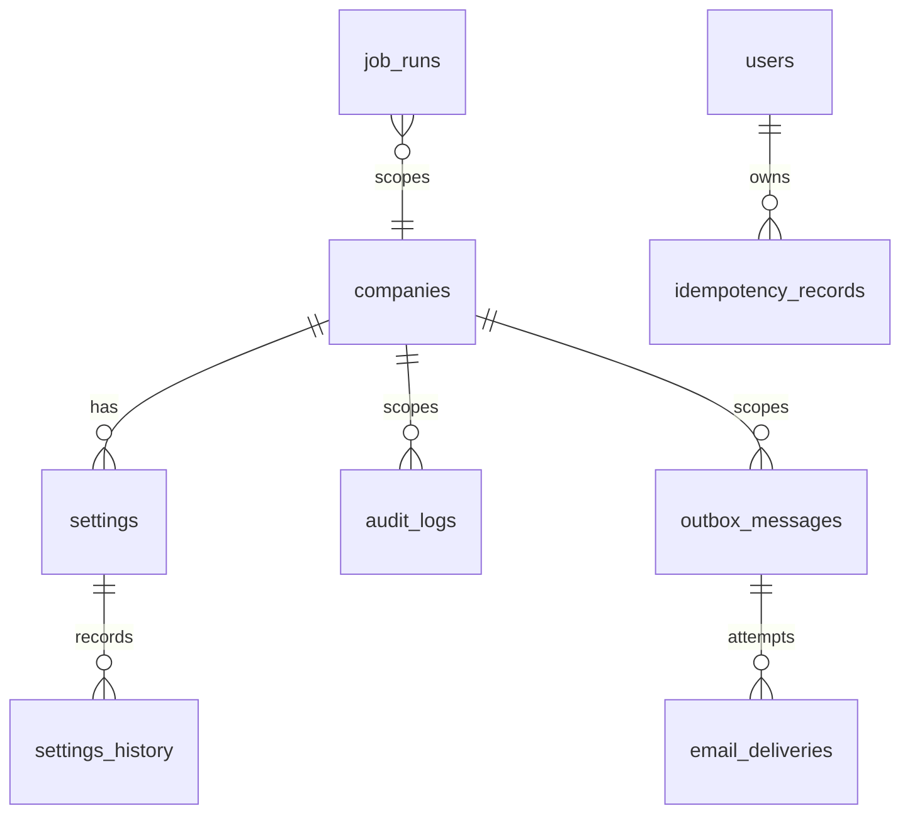
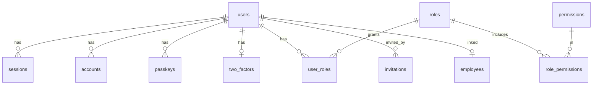
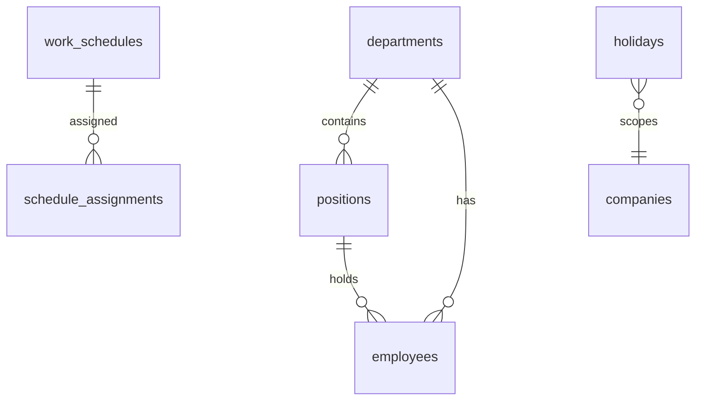
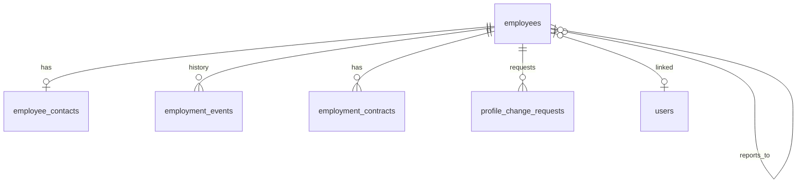
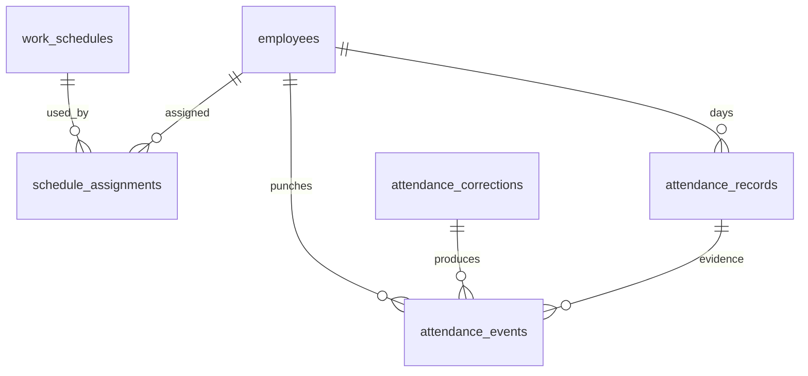
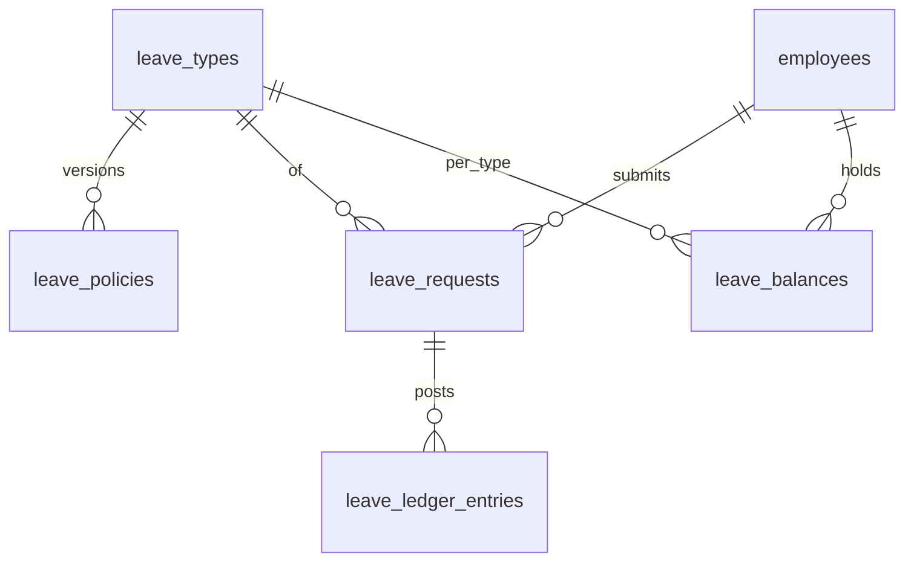
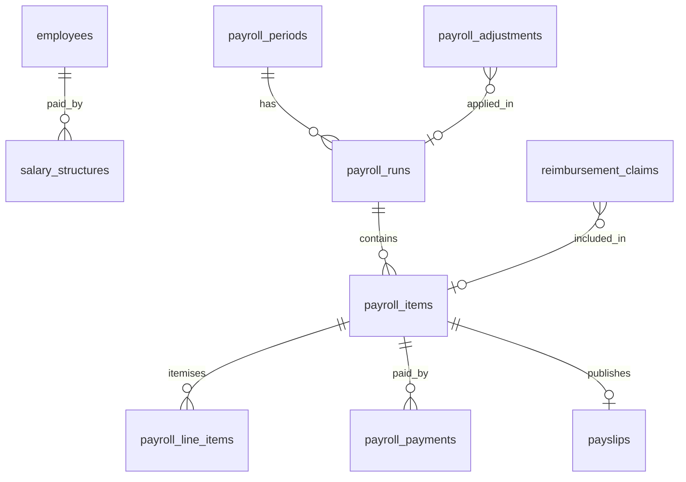

# Data model

Status: **Accepted**, 2026-10-22. Normative. This document specifies every PostgreSQL table for v1: columns, types, constraints, indexes and immutability. Entity names, enums and state machines come from `DOMAIN-MODEL.md`; permissions from `SECURITY-MODEL.md`. When this document and a Drizzle schema disagree, the schema is the bug.

Conventions used below (full rules in `docs/05-backend/DATABASE-CONVENTIONS.md`):

- DDL is written as PostgreSQL 16 and is the specification for the Drizzle schema in `packages/db`. Drizzle property names are camelCase; column names are snake_case.
- `id uuid PRIMARY KEY` is a UUID v7 generated by the application (`uuidv7()`), never by the database.
- "Standard columns" means `created_at timestamptz NOT NULL DEFAULT now()`, `updated_at timestamptz NOT NULL DEFAULT now()`, `created_by uuid NULL REFERENCES users(id) ON DELETE RESTRICT`, `updated_by uuid NULL REFERENCES users(id) ON DELETE RESTRICT`, `version integer NOT NULL DEFAULT 1`. A `NULL` actor means a system job.
- "Company column" means `company_id uuid NOT NULL REFERENCES companies(id) ON DELETE RESTRICT`. It exists on every organization-scoped table (D-001).
- Enums are PostgreSQL `enum` types named after the `DOMAIN-MODEL.md` enum (for example `employee_status`). Adding a value is an additive migration; removing one is forbidden.
- Money is `numeric(14,2)`. Leave quantities are `numeric(6,2)`. Minutes are `integer`.
- All foreign keys use `ON DELETE RESTRICT` unless stated. No business table uses `CASCADE`, so deleting a parent can never remove financial, leave, attendance or audit history (SRS §5.5).
- `citext` requires `CREATE EXTENSION IF NOT EXISTS citext;` in the first migration.

## Immutability summary

| Table | Rule | Enforcement |
|---|---|---|
| `audit_logs` | append-only | app role has `INSERT, SELECT` only |
| `settings_history` | append-only | app role has `INSERT, SELECT` only |
| `attendance_events` | append-only | app role has `INSERT, SELECT` only |
| `leave_ledger_entries` | append-only | app role has `INSERT, SELECT` only |
| `employment_events` | append-only except `status` (`scheduled` to `applied` or `cancelled`) | trigger `employment_events_guard` |
| `document_versions` | append-only | app role has `INSERT, SELECT` only |
| `approval_steps` | immutable once `decision <> 'pending'` | trigger `approval_steps_guard` |
| `payroll_items`, `payroll_line_items` | immutable once the run is `locked` or later | trigger `payroll_locked_guard` |
| `payroll_runs` | only `status`, payment and publication fields change after `locked` | trigger `payroll_locked_guard` |
| `salary_structures` | rows referenced by a locked payroll item cannot change `gross_amount`, `effective_from` | trigger `salary_structures_guard` |

The application connects as role `hrm_app`. Migrations run as role `hrm_owner`. Grants are part of the migrations (see `DATABASE-CONVENTIONS.md`).

## 1. Platform



### companies

One row in v1. Holds the identity of the organization; operating parameters live in `settings`.

```sql
CREATE TABLE companies (
  id              uuid PRIMARY KEY,
  name            text NOT NULL CHECK (length(name) BETWEEN 1 AND 200),
  legal_name      text NULL,
  logo_document_id uuid NULL,              -- FK added after documents exists
  email           citext NULL,
  phone           text NULL,
  address         text NULL,
  timezone        text NOT NULL DEFAULT 'Asia/Dhaka',
  currency        char(3) NOT NULL DEFAULT 'BDT' CHECK (currency ~ '^[A-Z]{3}$'),
  -- standard columns
);
```

### settings and settings_history

Key/value business settings (FR-SET-002). `scope` drives the permission needed to change the key (`settings.technical.manage`, `settings.hr.manage`, `settings.payroll.manage`). The key catalogue is in `docs/05-backend/BUSINESS-RULES.md` section 9.

```sql
CREATE TYPE setting_scope AS ENUM ('technical', 'hr', 'payroll');

CREATE TABLE settings (
  company_id  uuid NOT NULL REFERENCES companies(id) ON DELETE RESTRICT,
  key         text NOT NULL CHECK (key ~ '^[a-z][a-z0-9_.]{2,99}$'),
  scope       setting_scope NOT NULL,
  value       jsonb NOT NULL,
  -- standard columns
  PRIMARY KEY (company_id, key)
);

CREATE TABLE settings_history (            -- append-only
  id          uuid PRIMARY KEY,
  company_id  uuid NOT NULL,
  key         text NOT NULL,
  old_value   jsonb NULL,
  new_value   jsonb NOT NULL,
  changed_by  uuid NULL REFERENCES users(id) ON DELETE RESTRICT,
  changed_at  timestamptz NOT NULL DEFAULT now(),
  FOREIGN KEY (company_id, key) REFERENCES settings(company_id, key) ON DELETE RESTRICT
);
CREATE INDEX settings_history_key_idx ON settings_history (company_id, key, changed_at DESC);
```

### audit_logs

Append-only (FR-AUD-003). Event catalogue and redaction rules: `docs/05-backend/AUDIT.md`.

```sql
CREATE TABLE audit_logs (
  id            uuid PRIMARY KEY,
  company_id    uuid NOT NULL REFERENCES companies(id) ON DELETE RESTRICT,
  occurred_at   timestamptz NOT NULL DEFAULT now(),
  actor_user_id uuid NULL REFERENCES users(id) ON DELETE RESTRICT,   -- NULL = system job
  actor_type    text NOT NULL CHECK (actor_type IN ('user', 'system')),
  action        text NOT NULL CHECK (action ~ '^[a-z_]+\.[a-z_.]+$'),  -- e.g. leave_request.approved
  category      text NOT NULL CHECK (category IN ('business', 'payroll', 'security', 'technical')),
  entity_type   text NOT NULL,
  entity_id     uuid NULL,
  employee_id   uuid NULL REFERENCES employees(id) ON DELETE RESTRICT, -- subject employee, for scoping
  request_id    text NULL,
  ip_address    inet NULL,
  user_agent    text NULL,
  metadata      jsonb NOT NULL DEFAULT '{}'::jsonb
);
CREATE INDEX audit_logs_occurred_idx ON audit_logs (company_id, occurred_at DESC);
CREATE INDEX audit_logs_entity_idx   ON audit_logs (entity_type, entity_id, occurred_at DESC);
CREATE INDEX audit_logs_actor_idx    ON audit_logs (actor_user_id, occurred_at DESC);
CREATE INDEX audit_logs_action_idx   ON audit_logs (company_id, action, occurred_at DESC);
CREATE INDEX audit_logs_employee_idx ON audit_logs (employee_id, occurred_at DESC);
```

### outbox_messages and email_deliveries

Transactional outbox (ADR-0002, D-036). Processing rules: `docs/05-backend/JOBS-AND-OUTBOX.md`.

```sql
CREATE TYPE outbox_status AS ENUM ('pending', 'processing', 'sent', 'failed', 'dead');

CREATE TABLE outbox_messages (
  id             uuid PRIMARY KEY,
  company_id     uuid NOT NULL REFERENCES companies(id) ON DELETE RESTRICT,
  topic          text NOT NULL,                 -- e.g. email.leave_request_decided
  payload        jsonb NOT NULL,
  dedupe_key     text NULL,                     -- same key = same message
  status         outbox_status NOT NULL DEFAULT 'pending',
  attempts       integer NOT NULL DEFAULT 0 CHECK (attempts >= 0),
  next_attempt_at timestamptz NOT NULL DEFAULT now(),
  locked_until   timestamptz NULL,
  last_error     text NULL,
  created_at     timestamptz NOT NULL DEFAULT now(),
  processed_at   timestamptz NULL
);
CREATE UNIQUE INDEX outbox_dedupe_uq ON outbox_messages (company_id, dedupe_key) WHERE dedupe_key IS NOT NULL;
CREATE INDEX outbox_due_idx ON outbox_messages (next_attempt_at) WHERE status IN ('pending', 'failed');

CREATE TABLE email_deliveries (
  id                 uuid PRIMARY KEY,
  outbox_message_id  uuid NULL REFERENCES outbox_messages(id) ON DELETE RESTRICT,  -- NULL for inline sign-in OTP emails
  template           text NOT NULL,
  to_address         citext NOT NULL,
  provider           text NOT NULL DEFAULT 'gmail',
  provider_message_id text NULL,
  status             text NOT NULL CHECK (status IN ('sent', 'failed')),
  error              text NULL,
  attempted_at       timestamptz NOT NULL DEFAULT now()
);
CREATE INDEX email_deliveries_outbox_idx ON email_deliveries (outbox_message_id);
```

Sign-in OTP emails do **not** go through the outbox: they are sent inline because the user is waiting (see `docs/05-backend/EMAIL.md`). Their delivery attempts are still written to `email_deliveries`, with `outbox_message_id` NULL.

### idempotency_records

```sql
CREATE TABLE idempotency_records (
  id              uuid PRIMARY KEY,
  user_id         uuid NOT NULL REFERENCES users(id) ON DELETE RESTRICT,
  idempotency_key text NOT NULL CHECK (length(idempotency_key) BETWEEN 8 AND 100),
  operation       text NOT NULL,           -- e.g. POST /payroll/runs/{id}/lock
  request_hash    text NOT NULL,           -- SHA-256 of canonical request body
  status          text NOT NULL CHECK (status IN ('in_progress', 'completed')),
  response_status integer NULL,
  response_body   jsonb NULL,
  created_at      timestamptz NOT NULL DEFAULT now(),
  expires_at      timestamptz NOT NULL,     -- created_at + 24 h
  UNIQUE (user_id, idempotency_key, operation)
);
CREATE INDEX idempotency_expiry_idx ON idempotency_records (expires_at);
```

### job_runs

```sql
CREATE TABLE job_runs (
  id           uuid PRIMARY KEY,
  company_id   uuid NOT NULL REFERENCES companies(id) ON DELETE RESTRICT,
  job          text NOT NULL,             -- e.g. leave.accrue
  run_key      text NOT NULL,             -- e.g. 2026-11 for monthly jobs, date for daily
  status       text NOT NULL CHECK (status IN ('running', 'succeeded', 'failed')),
  started_at   timestamptz NOT NULL DEFAULT now(),
  finished_at  timestamptz NULL,
  items        integer NOT NULL DEFAULT 0,
  error        text NULL,
  UNIQUE (company_id, job, run_key)
);
CREATE INDEX job_runs_recent_idx ON job_runs (job, started_at DESC);
```

The unique `(job, run_key)` makes scheduled jobs run at most once per period.

## 2. Identity and access



Better Auth owns `users` (core fields), `sessions`, `accounts`, `verifications`, `passkeys`, `two_factors` and `rate_limits`. We rename its models to plural snake_case through `modelName`, and add our own fields through `user.additionalFields` and `session.additionalFields` (`AUTH-IMPLEMENTATION.md`). Better Auth ids use our `uuidv7()` generator, so all user ids are `uuid`.

### users

```sql
CREATE TYPE user_status AS ENUM ('invited', 'active', 'suspended', 'deactivated');
CREATE TYPE theme AS ENUM ('ink', 'paper');

CREATE TABLE users (
  id              uuid PRIMARY KEY,
  company_id      uuid NOT NULL REFERENCES companies(id) ON DELETE RESTRICT,
  email           citext NOT NULL UNIQUE,         -- case-insensitive unique (SRS 5.5)
  email_verified  boolean NOT NULL DEFAULT false,
  name            text NOT NULL,
  image           text NULL,
  status          user_status NOT NULL DEFAULT 'invited',
  theme           theme NOT NULL DEFAULT 'ink',    -- D-040
  locale          text NOT NULL DEFAULT 'en' CHECK (locale IN ('en', 'bn')),
  two_factor_enabled boolean NOT NULL DEFAULT false, -- Better Auth twoFactor field
  last_login_at   timestamptz NULL,
  status_changed_at timestamptz NULL,
  -- standard columns
);
CREATE INDEX users_status_idx ON users (company_id, status);
```

### sessions

```sql
CREATE TABLE sessions (
  id           uuid PRIMARY KEY,
  user_id      uuid NOT NULL REFERENCES users(id) ON DELETE CASCADE,  -- sessions are not history
  token        text NOT NULL UNIQUE,
  expires_at   timestamptz NOT NULL,
  ip_address   text NULL,
  user_agent   text NULL,
  strong_auth_at timestamptz NULL,     -- set when passkey or TOTP verified (D-033)
  auth_method  text NULL CHECK (auth_method IN ('passkey', 'email_otp')),
  created_at   timestamptz NOT NULL DEFAULT now(),
  updated_at   timestamptz NOT NULL DEFAULT now()
);
CREATE INDEX sessions_user_idx ON sessions (user_id);
CREATE INDEX sessions_expiry_idx ON sessions (expires_at);
```

Sessions use `CASCADE` because they carry no business history; users are never deleted anyway.

### accounts, verifications, passkeys, two_factors, rate_limits

Shapes follow the Better Auth version pinned in `packages/auth` (run `npx @better-auth/cli generate` and commit the result). Required properties:

| Table | Key columns | Notes |
|---|---|---|
| `accounts` | `id`, `user_id` FK CASCADE, `account_id`, `provider_id` | One row per sign-in provider. Passwordless users have no `password`. `UNIQUE (provider_id, account_id)` |
| `verifications` | `id`, `identifier`, `value`, `expires_at` | Holds email OTP codes; Better Auth stores them hashed when `storeOTP: 'hashed'`. Index on `identifier` |
| `passkeys` | `id`, `user_id` FK CASCADE, `credential_id` UNIQUE, `public_key`, `counter`, `device_type`, `backed_up`, `transports`, `name`, `created_at` | WebAuthn credentials, RP ID = Worker hostname |
| `two_factors` | `id`, `user_id` FK CASCADE UNIQUE, `secret`, `backup_codes` | `secret` and `backup_codes` are encrypted by Better Auth |
| `rate_limits` | `id`, `key` UNIQUE, `count`, `last_request` | Database rate-limit storage, because Worker memory is per isolate |

### roles, permissions, role_permissions, user_roles

Seeded from `SECURITY-MODEL.md` section 4. `manager` and `employee` are **derived** roles: they exist in `roles` (so permissions can be mapped) but are never inserted into `user_roles`; the policy layer adds them at request time.

```sql
CREATE TABLE roles (
  id          uuid PRIMARY KEY,
  company_id  uuid NOT NULL REFERENCES companies(id) ON DELETE RESTRICT,
  code        text NOT NULL CHECK (code ~ '^[a-z_]{3,40}$'),
  name        text NOT NULL,
  description text NULL,
  is_derived  boolean NOT NULL DEFAULT false,   -- manager, employee
  requires_strong_auth boolean NOT NULL DEFAULT false,
  is_active   boolean NOT NULL DEFAULT true,
  -- standard columns
  UNIQUE (company_id, code)
);

CREATE TABLE permissions (
  code        text PRIMARY KEY CHECK (code ~ '^[a-z_]+(\.[a-z_]+){1,3}$'),  -- e.g. leave.request.review.team
  description text NOT NULL
);

CREATE TABLE role_permissions (
  role_id         uuid NOT NULL REFERENCES roles(id) ON DELETE RESTRICT,
  permission_code text NOT NULL REFERENCES permissions(code) ON DELETE RESTRICT,
  granted_by      uuid NULL REFERENCES users(id) ON DELETE RESTRICT,
  granted_at      timestamptz NOT NULL DEFAULT now(),
  PRIMARY KEY (role_id, permission_code)
);

CREATE TABLE user_roles (
  user_id     uuid NOT NULL REFERENCES users(id) ON DELETE RESTRICT,
  role_id     uuid NOT NULL REFERENCES roles(id) ON DELETE RESTRICT,
  granted_by  uuid NULL REFERENCES users(id) ON DELETE RESTRICT,
  granted_at  timestamptz NOT NULL DEFAULT now(),
  PRIMARY KEY (user_id, role_id)
);
CREATE INDEX user_roles_role_idx ON user_roles (role_id);
```

A trigger `user_roles_no_derived` rejects inserts whose role has `is_derived = true`. Role and permission changes are audited (`role.granted`, `role.revoked`, `role.permissions_changed`); removing a row is allowed because the audit log keeps the history.

### invitations

```sql
CREATE TABLE invitations (
  id           uuid PRIMARY KEY,
  company_id   uuid NOT NULL REFERENCES companies(id) ON DELETE RESTRICT,
  user_id      uuid NOT NULL REFERENCES users(id) ON DELETE RESTRICT,   -- user created in 'invited'
  token_hash   text NOT NULL UNIQUE,      -- SHA-256 of the emailed token
  expires_at   timestamptz NOT NULL,      -- now() + 7 days
  accepted_at  timestamptz NULL,
  revoked_at   timestamptz NULL,
  -- standard columns
);
CREATE INDEX invitations_user_idx ON invitations (user_id);
```

## 3. Organization



```sql
CREATE TABLE departments (
  id          uuid PRIMARY KEY,
  company_id  uuid NOT NULL REFERENCES companies(id) ON DELETE RESTRICT,
  code        text NOT NULL CHECK (code ~ '^[A-Z0-9-]{2,20}$'),
  name        text NOT NULL,
  head_employee_id uuid NULL,        -- FK added after employees exists
  is_active   boolean NOT NULL DEFAULT true,
  -- standard columns
  UNIQUE (company_id, code)
);
CREATE UNIQUE INDEX departments_name_uq ON departments (company_id, lower(name));

CREATE TABLE positions (
  id            uuid PRIMARY KEY,
  company_id    uuid NOT NULL REFERENCES companies(id) ON DELETE RESTRICT,
  department_id uuid NULL REFERENCES departments(id) ON DELETE RESTRICT,
  title         text NOT NULL,
  grade         text NULL,
  is_active     boolean NOT NULL DEFAULT true,
  -- standard columns
);
CREATE UNIQUE INDEX positions_title_uq ON positions (company_id, coalesce(department_id, '00000000-0000-0000-0000-000000000000'::uuid), lower(title));

CREATE TABLE work_schedules (
  id                 uuid PRIMARY KEY,
  company_id         uuid NOT NULL REFERENCES companies(id) ON DELETE RESTRICT,
  name               text NOT NULL,
  timezone           text NOT NULL DEFAULT 'Asia/Dhaka',
  working_days       smallint[] NOT NULL DEFAULT '{0,1,2,3,4}',  -- ISO weekday 0=Sun .. 6=Sat; D-005 Sun-Thu
  core_start         time NOT NULL,          -- core window (D-010)
  core_end           time NOT NULL,
  min_daily_minutes  integer NOT NULL CHECK (min_daily_minutes BETWEEN 0 AND 1440),
  break_minutes      integer NOT NULL DEFAULT 0 CHECK (break_minutes BETWEEN 0 AND 480),
  is_default         boolean NOT NULL DEFAULT false,
  is_active          boolean NOT NULL DEFAULT true,
  -- standard columns
  CHECK (core_end > core_start),           -- single day shift, no overnight (D-011)
  CHECK (working_days <@ '{0,1,2,3,4,5,6}'::smallint[] AND cardinality(working_days) BETWEEN 1 AND 7)
);
CREATE UNIQUE INDEX work_schedules_default_uq ON work_schedules (company_id) WHERE is_default;

CREATE TYPE holiday_type AS ENUM ('public', 'festival', 'company', 'optional');

CREATE TABLE holidays (
  id          uuid PRIMARY KEY,
  company_id  uuid NOT NULL REFERENCES companies(id) ON DELETE RESTRICT,
  date        date NOT NULL,
  name        text NOT NULL,
  type        holiday_type NOT NULL DEFAULT 'public',
  -- standard columns
  UNIQUE (company_id, date)
);
```

The weekday numbering `0 = Sunday` matches JavaScript `Date.getDay()`; the name is `working_days`, not ISO, to avoid confusion with ISO 8601 (Monday = 1).

## 4. Employees



### employees

```sql
CREATE TYPE employee_status AS ENUM ('draft', 'preboarding', 'probation', 'active', 'notice_period', 'separated', 'archived');

CREATE TABLE employees (
  id               uuid PRIMARY KEY,
  company_id       uuid NOT NULL REFERENCES companies(id) ON DELETE RESTRICT,
  user_id          uuid NULL UNIQUE REFERENCES users(id) ON DELETE RESTRICT,  -- FR-AUTH-009/010
  employee_code    text NOT NULL,
  first_name       text NOT NULL,
  last_name        text NOT NULL,
  preferred_name   text NULL,
  work_email       citext NULL,
  work_phone       text NULL,
  date_of_birth    date NULL,
  gender           text NULL CHECK (gender IN ('female', 'male', 'other', 'undisclosed')),
  status           employee_status NOT NULL DEFAULT 'draft',
  department_id    uuid NULL REFERENCES departments(id) ON DELETE RESTRICT,
  position_id      uuid NULL REFERENCES positions(id) ON DELETE RESTRICT,
  manager_id       uuid NULL REFERENCES employees(id) ON DELETE RESTRICT,
  joining_date     date NULL,
  probation_end_date date NULL,
  separation_date  date NULL,
  separation_type  text NULL CHECK (separation_type IN ('resignation', 'termination', 'contract_end', 'retirement', 'death', 'other')),
  archived_at      timestamptz NULL,
  -- standard columns
  UNIQUE (company_id, employee_code),                      -- FR-EMP-002
  CHECK (manager_id IS NULL OR manager_id <> id),          -- FR-ORG-004
  CHECK (status IN ('draft', 'preboarding') OR joining_date IS NOT NULL),
  CHECK (separation_date IS NULL OR joining_date IS NULL OR separation_date >= joining_date)
);
CREATE UNIQUE INDEX employees_work_email_uq ON employees (company_id, work_email) WHERE work_email IS NOT NULL;  -- FR-EMP-009
CREATE INDEX employees_manager_idx    ON employees (manager_id);
CREATE INDEX employees_department_idx ON employees (company_id, department_id);
CREATE INDEX employees_status_idx     ON employees (company_id, status);
CREATE INDEX employees_name_trgm_idx  ON employees USING gin ((first_name || ' ' || last_name) gin_trgm_ops);  -- search; needs pg_trgm
```

Reporting cycles (FR-ORG-005) are rejected by the service with a recursive query before save (`BUSINESS-RULES.md` section 7); a database trigger is not used because cycles span rows.

### code_sequences

Gap-free human-readable codes (`EMP-0001`, `LV-000123`, `PR-2026-11-01`) come from one counter table locked with `SELECT ... FOR UPDATE`.

```sql
CREATE TABLE code_sequences (
  company_id  uuid NOT NULL REFERENCES companies(id) ON DELETE RESTRICT,
  scope       text NOT NULL CHECK (scope IN ('employee', 'leave_request', 'reimbursement_claim', 'payroll_run')),
  next_value  bigint NOT NULL DEFAULT 1 CHECK (next_value > 0),
  PRIMARY KEY (company_id, scope)
);
```

### employee_contacts

Restricted contact data (`employee.contact.read.all` or own). One row per employee.

```sql
CREATE TABLE employee_contacts (
  employee_id        uuid PRIMARY KEY REFERENCES employees(id) ON DELETE RESTRICT,
  personal_email     citext NULL,
  personal_phone     text NULL,
  present_address    text NULL,
  permanent_address  text NULL,
  national_id_number text NULL,      -- NID; never logged or audited in full
  emergency_contacts jsonb NOT NULL DEFAULT '[]'::jsonb
                     CHECK (jsonb_typeof(emergency_contacts) = 'array'),  -- [{name, relationship, phone}]
  -- standard columns
);
```

### employment_events

Effective-dated history (FR-EMP-005). Append-only except `status`.

```sql
CREATE TYPE employment_event_type AS ENUM ('hired', 'confirmed', 'promoted', 'transferred', 'manager_changed',
  'position_changed', 'salary_changed', 'status_changed', 'separated', 'rehired');

CREATE TABLE employment_events (
  id              uuid PRIMARY KEY,
  company_id      uuid NOT NULL REFERENCES companies(id) ON DELETE RESTRICT,
  employee_id     uuid NOT NULL REFERENCES employees(id) ON DELETE RESTRICT,
  type            employment_event_type NOT NULL,
  effective_date  date NOT NULL,
  status          text NOT NULL DEFAULT 'scheduled' CHECK (status IN ('scheduled', 'applied', 'cancelled')),
  changes         jsonb NOT NULL,      -- {"field": {"from": x, "to": y}}; salary amounts excluded (see salary_structures)
  reason          text NULL,
  applied_at      timestamptz NULL,
  created_at      timestamptz NOT NULL DEFAULT now(),
  created_by      uuid NULL REFERENCES users(id) ON DELETE RESTRICT
);
CREATE INDEX employment_events_employee_idx ON employment_events (employee_id, effective_date DESC);
CREATE INDEX employment_events_due_idx ON employment_events (effective_date) WHERE status = 'scheduled';
```

`salary_changed` events reference the `salary_structures.id` in `changes` but never copy the amount, so the event is readable with `employee.read.all`.

### employment_contracts

```sql
CREATE TYPE contract_type AS ENUM ('permanent', 'probation', 'fixed_term', 'intern', 'consultant');

CREATE TABLE employment_contracts (
  id            uuid PRIMARY KEY,
  company_id    uuid NOT NULL REFERENCES companies(id) ON DELETE RESTRICT,
  employee_id   uuid NOT NULL REFERENCES employees(id) ON DELETE RESTRICT,
  type          contract_type NOT NULL,
  start_date    date NOT NULL,
  end_date      date NULL,
  status        text NOT NULL DEFAULT 'active' CHECK (status IN ('draft', 'active', 'expired', 'terminated', 'superseded')),
  document_id   uuid NULL REFERENCES documents(id) ON DELETE RESTRICT,
  notes         text NULL,
  -- standard columns
  CHECK (end_date IS NULL OR end_date >= start_date),
  CHECK (type <> 'fixed_term' OR end_date IS NOT NULL)
);
CREATE INDEX employment_contracts_employee_idx ON employment_contracts (employee_id, start_date DESC);
CREATE INDEX employment_contracts_expiry_idx ON employment_contracts (end_date) WHERE status = 'active' AND end_date IS NOT NULL;
```

### profile_change_requests

```sql
CREATE TABLE profile_change_requests (
  id            uuid PRIMARY KEY,
  company_id    uuid NOT NULL REFERENCES companies(id) ON DELETE RESTRICT,
  employee_id   uuid NOT NULL REFERENCES employees(id) ON DELETE RESTRICT,
  status        text NOT NULL DEFAULT 'pending' CHECK (status IN ('pending', 'approved', 'rejected', 'withdrawn')),
  changes       jsonb NOT NULL,      -- allow-listed fields only: {"personalPhone": {"from": .., "to": ..}}
  reason        text NULL,
  decided_at    timestamptz NULL,
  decided_by    uuid NULL REFERENCES users(id) ON DELETE RESTRICT,
  decision_comment text NULL,
  -- standard columns
);
CREATE INDEX profile_change_requests_employee_idx ON profile_change_requests (employee_id, created_at DESC);
CREATE UNIQUE INDEX profile_change_requests_one_pending_uq ON profile_change_requests (employee_id) WHERE status = 'pending';
```

## 5. Attendance



```sql
CREATE TABLE schedule_assignments (
  id               uuid PRIMARY KEY,
  company_id       uuid NOT NULL REFERENCES companies(id) ON DELETE RESTRICT,
  employee_id      uuid NOT NULL REFERENCES employees(id) ON DELETE RESTRICT,
  work_schedule_id uuid NOT NULL REFERENCES work_schedules(id) ON DELETE RESTRICT,
  effective_from   date NOT NULL,
  effective_to     date NULL,        -- inclusive; NULL = open-ended
  -- standard columns
  CHECK (effective_to IS NULL OR effective_to >= effective_from),
  EXCLUDE USING gist (employee_id WITH =, daterange(effective_from, effective_to, '[]') WITH &&)  -- needs btree_gist
);

CREATE TYPE attendance_event_type AS ENUM ('check_in', 'check_out', 'manual_entry', 'correction');
CREATE TYPE attendance_source AS ENUM ('web', 'manual', 'correction', 'system');

CREATE TABLE attendance_events (            -- append-only (FR-ATT-008)
  id               uuid PRIMARY KEY,
  company_id       uuid NOT NULL REFERENCES companies(id) ON DELETE RESTRICT,
  employee_id      uuid NOT NULL REFERENCES employees(id) ON DELETE RESTRICT,
  work_date        date NOT NULL,                     -- Asia/Dhaka date of the check-in (D-011)
  type             attendance_event_type NOT NULL,
  occurred_at      timestamptz NOT NULL,              -- the punch time being asserted
  recorded_at      timestamptz NOT NULL DEFAULT now(),
  source           attendance_source NOT NULL,
  -- manual_entry and correction events assert a full pair
  check_in_at      timestamptz NULL,
  check_out_at     timestamptz NULL,
  correction_id    uuid NULL REFERENCES attendance_corrections(id) ON DELETE RESTRICT,
  reason           text NULL,
  ip_address       inet NULL,                          -- evidence only (D-009)
  user_agent       text NULL,
  recorded_by      uuid NULL REFERENCES users(id) ON DELETE RESTRICT,
  CHECK (type NOT IN ('manual_entry', 'correction') OR reason IS NOT NULL),
  CHECK (type <> 'correction' OR correction_id IS NOT NULL),
  CHECK (check_out_at IS NULL OR check_in_at IS NULL OR check_out_at > check_in_at)
);
CREATE INDEX attendance_events_day_idx ON attendance_events (employee_id, work_date, recorded_at);

CREATE TYPE attendance_status AS ENUM ('present', 'short_hours', 'missed_core', 'missing_punch', 'absent',
  'on_leave', 'holiday', 'weekend', 'not_employed');

CREATE TABLE attendance_records (           -- derived; recomputed from events
  id                uuid PRIMARY KEY,
  company_id        uuid NOT NULL REFERENCES companies(id) ON DELETE RESTRICT,
  employee_id       uuid NOT NULL REFERENCES employees(id) ON DELETE RESTRICT,
  work_date         date NOT NULL,
  work_schedule_id  uuid NULL REFERENCES work_schedules(id) ON DELETE RESTRICT,
  first_in_at       timestamptz NULL,
  last_out_at       timestamptz NULL,
  worked_minutes    integer NOT NULL DEFAULT 0 CHECK (worked_minutes >= 0),
  late_minutes      integer NOT NULL DEFAULT 0 CHECK (late_minutes >= 0),       -- reported only (D-010)
  early_leave_minutes integer NOT NULL DEFAULT 0 CHECK (early_leave_minutes >= 0),
  status            attendance_status NOT NULL,
  is_final          boolean NOT NULL DEFAULT false,       -- set by attendance.close_day
  needs_review      boolean NOT NULL DEFAULT false,       -- e.g. check-out after midnight
  has_correction    boolean NOT NULL DEFAULT false,
  computed_at       timestamptz NOT NULL DEFAULT now(),
  version           integer NOT NULL DEFAULT 1,
  UNIQUE (employee_id, work_date)
);
CREATE INDEX attendance_records_date_idx ON attendance_records (company_id, work_date, status);

CREATE TABLE attendance_corrections (
  id               uuid PRIMARY KEY,
  company_id       uuid NOT NULL REFERENCES companies(id) ON DELETE RESTRICT,
  employee_id      uuid NOT NULL REFERENCES employees(id) ON DELETE RESTRICT,
  work_date        date NOT NULL,
  status           text NOT NULL DEFAULT 'pending' CHECK (status IN ('pending', 'approved', 'rejected', 'withdrawn')),
  proposed_check_in_at  timestamptz NULL,
  proposed_check_out_at timestamptz NULL,
  reason           text NOT NULL CHECK (length(reason) BETWEEN 5 AND 1000),
  decided_at       timestamptz NULL,
  decided_by       uuid NULL REFERENCES users(id) ON DELETE RESTRICT,
  decision_comment text NULL,
  -- standard columns
  CHECK (proposed_check_in_at IS NOT NULL OR proposed_check_out_at IS NOT NULL)
);
CREATE INDEX attendance_corrections_employee_idx ON attendance_corrections (employee_id, work_date DESC);
CREATE UNIQUE INDEX attendance_corrections_pending_uq ON attendance_corrections (employee_id, work_date) WHERE status = 'pending';
```

`attendance_events.correction_id` creates a circular reference with `attendance_corrections`; create `attendance_corrections` first, then `attendance_events`.

## 6. Leave



```sql
CREATE TABLE leave_types (
  id              uuid PRIMARY KEY,
  company_id      uuid NOT NULL REFERENCES companies(id) ON DELETE RESTRICT,
  code            text NOT NULL CHECK (code ~ '^[A-Z]{2,10}$'),   -- CL, SL, AL, COMP
  name            text NOT NULL,
  is_paid         boolean NOT NULL DEFAULT true,     -- informational in v1; leave never affects pay (D-017)
  allows_half_day boolean NOT NULL DEFAULT true,
  requires_reason boolean NOT NULL DEFAULT false,
  requires_document_after_days numeric(6,2) NULL,  -- e.g. sick leave certificate; policy, owner decides
  color_token     text NULL,
  is_active       boolean NOT NULL DEFAULT true,
  sort_order      integer NOT NULL DEFAULT 0,
  -- standard columns
  UNIQUE (company_id, code)
);

CREATE TABLE leave_policies (                -- effective-dated; never edited once effective
  id                   uuid PRIMARY KEY,
  company_id           uuid NOT NULL REFERENCES companies(id) ON DELETE RESTRICT,
  leave_type_id        uuid NOT NULL REFERENCES leave_types(id) ON DELETE RESTRICT,
  effective_from       date NOT NULL,
  effective_to         date NULL,
  allocation_method    text NOT NULL CHECK (allocation_method IN ('annual_grant', 'monthly_accrual', 'per_days_worked', 'manual')),
  annual_entitlement   numeric(6,2) NULL CHECK (annual_entitlement >= 0),
  accrual_per_month    numeric(6,2) NULL CHECK (accrual_per_month >= 0),
  days_worked_per_unit numeric(6,2) NULL CHECK (days_worked_per_unit > 0),   -- e.g. 18 for earned leave
  prorate_first_year   boolean NOT NULL DEFAULT true,
  eligibility_after_days integer NOT NULL DEFAULT 0 CHECK (eligibility_after_days >= 0),
  eligible_statuses    employee_status[] NOT NULL DEFAULT '{probation,active,notice_period}',
  max_carry_forward    numeric(6,2) NULL CHECK (max_carry_forward >= 0),      -- NULL = no carry-forward
  max_balance          numeric(6,2) NULL CHECK (max_balance >= 0),
  carry_forward_expiry_months integer NULL CHECK (carry_forward_expiry_months BETWEEN 1 AND 24),
  allow_negative_balance boolean NOT NULL DEFAULT false,
  max_consecutive_days numeric(6,2) NULL,
  min_notice_days      integer NOT NULL DEFAULT 0,
  -- standard columns
  CHECK (effective_to IS NULL OR effective_to >= effective_from),
  EXCLUDE USING gist (leave_type_id WITH =, daterange(effective_from, effective_to, '[]') WITH &&)
);

CREATE TYPE leave_unit AS ENUM ('day', 'half_day');
CREATE TYPE half_day_part AS ENUM ('first_half', 'second_half');

CREATE TABLE leave_requests (
  id              uuid PRIMARY KEY,
  company_id      uuid NOT NULL REFERENCES companies(id) ON DELETE RESTRICT,
  request_number  text NOT NULL,                  -- LV-000123
  employee_id     uuid NOT NULL REFERENCES employees(id) ON DELETE RESTRICT,
  leave_type_id   uuid NOT NULL REFERENCES leave_types(id) ON DELETE RESTRICT,
  leave_policy_id uuid NOT NULL REFERENCES leave_policies(id) ON DELETE RESTRICT,  -- policy version applied
  start_date      date NOT NULL,
  end_date        date NOT NULL,
  unit            leave_unit NOT NULL DEFAULT 'day',
  half_day_part   half_day_part NULL,
  requested_units numeric(6,2) NOT NULL CHECK (requested_units > 0),  -- computed working days
  reason          text NULL,
  attachment_document_id uuid NULL REFERENCES documents(id) ON DELETE RESTRICT,
  status          text NOT NULL DEFAULT 'pending' CHECK (status IN ('draft', 'pending', 'approved', 'rejected',
                    'withdrawn', 'cancellation_pending', 'cancelled')),   -- 'draft' reserved, not used in v1
  submitted_at    timestamptz NULL,
  decided_at      timestamptz NULL,
  decided_by      uuid NULL REFERENCES users(id) ON DELETE RESTRICT,
  decision_comment text NULL,
  cancellation_reason text NULL,
  on_behalf_by    uuid NULL REFERENCES users(id) ON DELETE RESTRICT,   -- HR acting on behalf (D-014)
  -- standard columns
  UNIQUE (company_id, request_number),
  CHECK (end_date >= start_date),
  CHECK (unit = 'day' OR (start_date = end_date AND half_day_part IS NOT NULL AND requested_units = 0.5)),
  CHECK (unit = 'half_day' OR half_day_part IS NULL)
);
CREATE INDEX leave_requests_employee_idx ON leave_requests (employee_id, start_date DESC);
CREATE INDEX leave_requests_status_idx   ON leave_requests (company_id, status, start_date);
CREATE INDEX leave_requests_range_idx    ON leave_requests USING gist (employee_id, daterange(start_date, end_date, '[]'));
```

Overlap between an employee's active requests (`pending`, `approved`, `cancellation_pending`) is checked by the service, because half days on the same date (first and second half) are allowed.

```sql
CREATE TYPE leave_ledger_type AS ENUM ('grant', 'accrual', 'reservation', 'reservation_release', 'usage',
  'adjustment', 'reversal', 'carry_forward', 'expiry');

CREATE TABLE leave_ledger_entries (         -- append-only, authoritative (FR-LEAVE-008)
  id               uuid PRIMARY KEY,
  company_id       uuid NOT NULL REFERENCES companies(id) ON DELETE RESTRICT,
  employee_id      uuid NOT NULL REFERENCES employees(id) ON DELETE RESTRICT,
  leave_type_id    uuid NOT NULL REFERENCES leave_types(id) ON DELETE RESTRICT,
  leave_year       smallint NOT NULL CHECK (leave_year BETWEEN 2000 AND 2100),   -- calendar year (D-015)
  type             leave_ledger_type NOT NULL,
  amount           numeric(6,2) NOT NULL CHECK (amount <> 0),   -- signed: + adds, - consumes
  effective_date   date NOT NULL,
  leave_request_id uuid NULL REFERENCES leave_requests(id) ON DELETE RESTRICT,
  reverses_entry_id uuid NULL REFERENCES leave_ledger_entries(id) ON DELETE RESTRICT,
  policy_id        uuid NULL REFERENCES leave_policies(id) ON DELETE RESTRICT,
  job_run_id       uuid NULL REFERENCES job_runs(id) ON DELETE RESTRICT,
  reason           text NULL,
  created_at       timestamptz NOT NULL DEFAULT now(),
  created_by       uuid NULL REFERENCES users(id) ON DELETE RESTRICT,
  CHECK (type NOT IN ('reservation', 'reservation_release', 'usage', 'reversal') OR leave_request_id IS NOT NULL),
  CHECK (type <> 'adjustment' OR reason IS NOT NULL),
  CHECK ((type IN ('reservation', 'usage', 'expiry') AND amount < 0)
      OR (type IN ('grant', 'accrual', 'reservation_release', 'reversal', 'carry_forward') AND amount > 0)
      OR type = 'adjustment')
);
CREATE INDEX leave_ledger_balance_idx ON leave_ledger_entries (employee_id, leave_type_id, leave_year);
CREATE INDEX leave_ledger_request_idx ON leave_ledger_entries (leave_request_id);
CREATE UNIQUE INDEX leave_ledger_accrual_once_uq ON leave_ledger_entries (employee_id, leave_type_id, type, effective_date)
  WHERE type IN ('accrual', 'carry_forward', 'expiry');   -- jobs cannot double-post

CREATE TABLE leave_balances (               -- projection and lock row; ledger is authoritative
  employee_id    uuid NOT NULL REFERENCES employees(id) ON DELETE RESTRICT,
  leave_type_id  uuid NOT NULL REFERENCES leave_types(id) ON DELETE RESTRICT,
  leave_year     smallint NOT NULL,
  company_id     uuid NOT NULL REFERENCES companies(id) ON DELETE RESTRICT,
  entitled       numeric(6,2) NOT NULL DEFAULT 0,   -- grant + accrual + carry_forward + positive adjustments
  used           numeric(6,2) NOT NULL DEFAULT 0,   -- usage net of reversals
  reserved       numeric(6,2) NOT NULL DEFAULT 0,   -- open reservations
  adjusted       numeric(6,2) NOT NULL DEFAULT 0,   -- net adjustments and expiry
  available      numeric(6,2) GENERATED ALWAYS AS (entitled - used - reserved + adjusted) STORED,
  updated_at     timestamptz NOT NULL DEFAULT now(),
  version        integer NOT NULL DEFAULT 1,
  PRIMARY KEY (employee_id, leave_type_id, leave_year)
);
```

The service updates `leave_balances` in the same transaction as each ledger insert, after locking the row with `SELECT ... FOR UPDATE`. A nightly check (`maintenance.prune` sub-step) recomputes balances from the ledger and alerts on any difference.

## 7. Payroll



```sql
CREATE TABLE salary_structures (            -- effective-dated single gross amount (D-018)
  id              uuid PRIMARY KEY,
  company_id      uuid NOT NULL REFERENCES companies(id) ON DELETE RESTRICT,
  employee_id     uuid NOT NULL REFERENCES employees(id) ON DELETE RESTRICT,
  currency        char(3) NOT NULL DEFAULT 'BDT',
  gross_amount    numeric(14,2) NOT NULL CHECK (gross_amount >= 0),
  effective_from  date NOT NULL,
  effective_to    date NULL,
  status          text NOT NULL DEFAULT 'draft' CHECK (status IN ('draft', 'approved', 'superseded')),
  reason          text NULL,
  approved_at     timestamptz NULL,
  approved_by     uuid NULL REFERENCES users(id) ON DELETE RESTRICT,
  -- standard columns
  CHECK (effective_to IS NULL OR effective_to >= effective_from),
  EXCLUDE USING gist (employee_id WITH =, daterange(effective_from, effective_to, '[]') WITH &&) WHERE (status = 'approved')
);
CREATE INDEX salary_structures_employee_idx ON salary_structures (employee_id, effective_from DESC);

CREATE TABLE payroll_periods (
  id          uuid PRIMARY KEY,
  company_id  uuid NOT NULL REFERENCES companies(id) ON DELETE RESTRICT,
  year        smallint NOT NULL CHECK (year BETWEEN 2000 AND 2100),
  month       smallint NOT NULL CHECK (month BETWEEN 1 AND 12),
  start_date  date NOT NULL,
  end_date    date NOT NULL,
  status      text NOT NULL DEFAULT 'open' CHECK (status IN ('open', 'closed')),
  -- standard columns
  UNIQUE (company_id, year, month),
  CHECK (end_date >= start_date)
);

CREATE TYPE payroll_run_status AS ENUM ('draft', 'calculated', 'submitted', 'returned', 'approved', 'locked', 'paid', 'reconciled');

CREATE TABLE payroll_runs (
  id               uuid PRIMARY KEY,
  company_id       uuid NOT NULL REFERENCES companies(id) ON DELETE RESTRICT,
  payroll_period_id uuid NOT NULL REFERENCES payroll_periods(id) ON DELETE RESTRICT,
  run_number       text NOT NULL,                    -- PR-2026-11-01
  run_type         text NOT NULL DEFAULT 'regular' CHECK (run_type IN ('regular', 'off_cycle')),
  status           payroll_run_status NOT NULL DEFAULT 'draft',
  calculation_rule_version text NULL,                -- e.g. payroll-v1.0, from packages/domain
  calculated_at    timestamptz NULL,
  submitted_at     timestamptz NULL,
  prepared_by      uuid NULL REFERENCES users(id) ON DELETE RESTRICT,
  approved_at      timestamptz NULL,
  approved_by      uuid NULL REFERENCES users(id) ON DELETE RESTRICT,
  self_approved    boolean NOT NULL DEFAULT false,   -- D-007
  self_approval_note text NULL,
  returned_reason  text NULL,
  locked_at        timestamptz NULL,
  locked_by        uuid NULL REFERENCES users(id) ON DELETE RESTRICT,
  payslips_published_at timestamptz NULL,
  total_gross      numeric(14,2) NULL,
  total_deductions numeric(14,2) NULL,
  total_net        numeric(14,2) NULL,
  employee_count   integer NULL,
  -- standard columns
  UNIQUE (company_id, run_number),
  CHECK (NOT self_approved OR self_approval_note IS NOT NULL)
);
CREATE UNIQUE INDEX payroll_runs_one_regular_uq ON payroll_runs (payroll_period_id) WHERE run_type = 'regular';  -- SRS 5.5
CREATE INDEX payroll_runs_status_idx ON payroll_runs (company_id, status);

CREATE TABLE payroll_items (
  id                  uuid PRIMARY KEY,
  company_id          uuid NOT NULL REFERENCES companies(id) ON DELETE RESTRICT,
  payroll_run_id      uuid NOT NULL REFERENCES payroll_runs(id) ON DELETE RESTRICT,
  employee_id         uuid NOT NULL REFERENCES employees(id) ON DELETE RESTRICT,
  salary_structure_id uuid NULL REFERENCES salary_structures(id) ON DELETE RESTRICT,
  currency            char(3) NOT NULL DEFAULT 'BDT',
  gross_amount        numeric(14,2) NOT NULL,          -- earnings total
  deduction_amount    numeric(14,2) NOT NULL DEFAULT 0,
  net_amount          numeric(14,2) NOT NULL,
  days_in_period      smallint NOT NULL,
  days_employed       smallint NOT NULL,
  snapshot            jsonb NOT NULL,                  -- FR-PAY-007; shape in BUSINESS-RULES.md section 6.6
  validation_flags    text[] NOT NULL DEFAULT '{}',    -- e.g. {no_salary_structure, amount_change_over_threshold}
  payment_status      text NOT NULL DEFAULT 'unpaid' CHECK (payment_status IN ('unpaid', 'paid', 'failed', 'cancelled')),
  -- standard columns
  UNIQUE (payroll_run_id, employee_id),                -- FR-PAY-012
  CHECK (net_amount = gross_amount - deduction_amount),
  CHECK (days_employed BETWEEN 0 AND days_in_period)
);
CREATE INDEX payroll_items_employee_idx ON payroll_items (employee_id);

CREATE TYPE payroll_line_kind AS ENUM ('earning', 'deduction');
CREATE TYPE payroll_line_code AS ENUM ('base_salary', 'proration_adjustment', 'reimbursement', 'addition', 'deduction', 'arrears');

CREATE TABLE payroll_line_items (
  id              uuid PRIMARY KEY,
  payroll_item_id uuid NOT NULL REFERENCES payroll_items(id) ON DELETE RESTRICT,
  kind            payroll_line_kind NOT NULL,
  code            payroll_line_code NOT NULL,
  label           text NOT NULL,
  amount          numeric(14,2) NOT NULL CHECK (amount >= 0),   -- sign comes from kind
  sort_order      smallint NOT NULL DEFAULT 0,
  source_type     text NULL CHECK (source_type IN ('salary_structure', 'reimbursement_claim', 'payroll_adjustment')),
  source_id       uuid NULL,
  calculation     jsonb NOT NULL DEFAULT '{}'::jsonb,           -- inputs for this line
  created_at      timestamptz NOT NULL DEFAULT now()
);
CREATE INDEX payroll_line_items_item_idx ON payroll_line_items (payroll_item_id, sort_order);
```

`payroll_line_items.source_id` is a generic reference for display. Integrity is held by the concrete foreign keys in the other direction: `reimbursement_claims.payroll_item_id` and `payroll_adjustments.applied_payroll_item_id`.

```sql
CREATE TYPE adjustment_type AS ENUM ('addition', 'deduction');

CREATE TABLE payroll_adjustments (
  id               uuid PRIMARY KEY,
  company_id       uuid NOT NULL REFERENCES companies(id) ON DELETE RESTRICT,
  employee_id      uuid NOT NULL REFERENCES employees(id) ON DELETE RESTRICT,
  type             adjustment_type NOT NULL,
  line_code        payroll_line_code NOT NULL DEFAULT 'addition' CHECK (line_code IN ('addition', 'deduction', 'arrears')),
  amount           numeric(14,2) NOT NULL CHECK (amount > 0),
  reason           text NOT NULL CHECK (length(reason) BETWEEN 5 AND 1000),
  target_period_id uuid NOT NULL REFERENCES payroll_periods(id) ON DELETE RESTRICT,
  corrects_payroll_item_id uuid NULL REFERENCES payroll_items(id) ON DELETE RESTRICT,  -- correction of a locked run
  status           text NOT NULL DEFAULT 'pending' CHECK (status IN ('pending', 'approved', 'rejected', 'applied')),
  decided_at       timestamptz NULL,
  decided_by       uuid NULL REFERENCES users(id) ON DELETE RESTRICT,
  self_approved    boolean NOT NULL DEFAULT false,
  self_approval_note text NULL,
  applied_payroll_item_id uuid NULL REFERENCES payroll_items(id) ON DELETE RESTRICT,
  -- standard columns
  CHECK (status <> 'applied' OR applied_payroll_item_id IS NOT NULL),
  CHECK (NOT self_approved OR self_approval_note IS NOT NULL)
);
CREATE INDEX payroll_adjustments_period_idx ON payroll_adjustments (target_period_id, status);

CREATE TYPE payment_method AS ENUM ('cash', 'cheque');
CREATE TYPE payment_status AS ENUM ('unpaid', 'paid', 'failed', 'cancelled');

CREATE TABLE payroll_payments (
  id               uuid PRIMARY KEY,
  company_id       uuid NOT NULL REFERENCES companies(id) ON DELETE RESTRICT,
  payroll_item_id  uuid NOT NULL REFERENCES payroll_items(id) ON DELETE RESTRICT,
  method           payment_method NOT NULL,          -- D-021
  amount           numeric(14,2) NOT NULL CHECK (amount > 0),
  paid_on          date NOT NULL,
  cheque_number    text NULL,
  reference        text NULL,
  acknowledged_by_name text NULL,                    -- cash: who received it
  acknowledgment_document_id uuid NULL REFERENCES documents(id) ON DELETE RESTRICT,
  status           payment_status NOT NULL DEFAULT 'paid',
  cancelled_reason text NULL,
  -- standard columns
  CHECK (method <> 'cheque' OR cheque_number IS NOT NULL),
  CHECK (status <> 'cancelled' OR cancelled_reason IS NOT NULL)
);
CREATE INDEX payroll_payments_item_idx ON payroll_payments (payroll_item_id);
CREATE UNIQUE INDEX payroll_payments_cheque_uq ON payroll_payments (company_id, cheque_number) WHERE cheque_number IS NOT NULL AND status <> 'cancelled';

CREATE TABLE payslips (
  id               uuid PRIMARY KEY,
  company_id       uuid NOT NULL REFERENCES companies(id) ON DELETE RESTRICT,
  payroll_item_id  uuid NOT NULL UNIQUE REFERENCES payroll_items(id) ON DELETE RESTRICT,
  employee_id      uuid NOT NULL REFERENCES employees(id) ON DELETE RESTRICT,
  payroll_period_id uuid NOT NULL REFERENCES payroll_periods(id) ON DELETE RESTRICT,
  published_at     timestamptz NOT NULL DEFAULT now(),
  published_by     uuid NULL REFERENCES users(id) ON DELETE RESTRICT,
  first_viewed_at  timestamptz NULL
);
CREATE INDEX payslips_employee_idx ON payslips (employee_id, published_at DESC);
```

Payments are never edited: a wrong payment is set to `cancelled` with a reason and a new row is inserted. `payroll_items.payment_status` is `paid` when the sum of non-cancelled payments equals `net_amount`.

## 8. Reimbursements

```sql
CREATE TABLE reimbursement_claims (
  id               uuid PRIMARY KEY,
  company_id       uuid NOT NULL REFERENCES companies(id) ON DELETE RESTRICT,
  claim_number     text NOT NULL,                    -- RC-000045
  employee_id      uuid NOT NULL REFERENCES employees(id) ON DELETE RESTRICT,
  category         text NOT NULL DEFAULT 'transport' CHECK (category IN ('transport')),  -- D-020, FR-REIM-001
  expense_date     date NOT NULL,
  amount           numeric(14,2) NOT NULL CHECK (amount > 0),
  currency         char(3) NOT NULL DEFAULT 'BDT',
  description      text NOT NULL CHECK (length(description) BETWEEN 3 AND 1000),
  receipt_document_id uuid NULL REFERENCES documents(id) ON DELETE RESTRICT,
  status           text NOT NULL DEFAULT 'draft' CHECK (status IN ('draft', 'submitted', 'approved', 'rejected',
                     'withdrawn', 'included', 'paid')),
  submitted_at     timestamptz NULL,
  decided_at       timestamptz NULL,
  decided_by       uuid NULL REFERENCES users(id) ON DELETE RESTRICT,
  decision_comment text NULL,
  payroll_item_id  uuid NULL REFERENCES payroll_items(id) ON DELETE RESTRICT,
  -- standard columns
  UNIQUE (company_id, claim_number),
  CHECK (status NOT IN ('included', 'paid') OR payroll_item_id IS NOT NULL)
);
CREATE INDEX reimbursement_claims_employee_idx ON reimbursement_claims (employee_id, expense_date DESC);
CREATE INDEX reimbursement_claims_status_idx ON reimbursement_claims (company_id, status);
```

Claim numbers use the `reimbursement_claim` scope of `code_sequences`.

## 9. Documents

```sql
CREATE TYPE document_category AS ENUM ('identity', 'contract', 'certificate', 'payslip', 'receipt', 'policy', 'other');

CREATE TABLE documents (
  id              uuid PRIMARY KEY,
  company_id      uuid NOT NULL REFERENCES companies(id) ON DELETE RESTRICT,
  employee_id     uuid NULL REFERENCES employees(id) ON DELETE RESTRICT,   -- NULL = company document (logo, policy)
  category        document_category NOT NULL,
  title           text NOT NULL,
  is_restricted   boolean NOT NULL DEFAULT false,   -- hidden from the employee's own view; access audited
  issue_date      date NULL,
  expiry_date     date NULL,
  current_version integer NOT NULL DEFAULT 1,
  status          text NOT NULL DEFAULT 'active' CHECK (status IN ('active', 'deleted')),
  deleted_at      timestamptz NULL,
  deleted_reason  text NULL,
  -- standard columns
  CHECK (expiry_date IS NULL OR issue_date IS NULL OR expiry_date >= issue_date),
  CHECK (status <> 'deleted' OR (deleted_at IS NOT NULL AND deleted_reason IS NOT NULL))
);
CREATE INDEX documents_employee_idx ON documents (employee_id, category);
CREATE INDEX documents_expiry_idx ON documents (expiry_date) WHERE status = 'active' AND expiry_date IS NOT NULL;

CREATE TABLE document_versions (            -- append-only (FR-DOC-005)
  id            uuid PRIMARY KEY,
  document_id   uuid NOT NULL REFERENCES documents(id) ON DELETE RESTRICT,
  version       integer NOT NULL CHECK (version > 0),
  storage_key   text NOT NULL UNIQUE,         -- documents/{employeeId|company}/{documentId}/v{n}
  file_name     text NOT NULL,
  mime_type     text NOT NULL CHECK (mime_type IN ('application/pdf', 'image/jpeg', 'image/png', 'image/webp')),
  size_bytes    integer NOT NULL CHECK (size_bytes BETWEEN 1 AND 10485760),   -- 10 MB (ADR-0009)
  sha256        char(64) NOT NULL,
  uploaded_at   timestamptz NOT NULL DEFAULT now(),
  uploaded_by   uuid NULL REFERENCES users(id) ON DELETE RESTRICT,
  UNIQUE (document_id, version)
);
```

After `documents` exists, the migration adds `companies.logo_document_id` and the document FKs on other tables. Retention deletion sets `documents.status = 'deleted'`, removes the R2 objects and keeps the metadata rows (see `JOBS-AND-OUTBOX.md`).

## 10. Approvals

The approval tables use one nullable foreign key per subject type instead of a polymorphic `subject_id`, so every reference is integrity-checked (SRS §5.5, last bullet).

```sql
CREATE TYPE approval_subject_type AS ENUM ('leave_request', 'attendance_correction', 'reimbursement_claim',
  'profile_change', 'payroll_run', 'payroll_adjustment');
CREATE TYPE approval_step_decision AS ENUM ('pending', 'approved', 'rejected', 'skipped');

CREATE TABLE approval_requests (
  id                         uuid PRIMARY KEY,
  company_id                 uuid NOT NULL REFERENCES companies(id) ON DELETE RESTRICT,
  subject_type               approval_subject_type NOT NULL,
  leave_request_id           uuid NULL REFERENCES leave_requests(id) ON DELETE RESTRICT,
  attendance_correction_id   uuid NULL REFERENCES attendance_corrections(id) ON DELETE RESTRICT,
  reimbursement_claim_id     uuid NULL REFERENCES reimbursement_claims(id) ON DELETE RESTRICT,
  profile_change_request_id  uuid NULL REFERENCES profile_change_requests(id) ON DELETE RESTRICT,
  payroll_run_id             uuid NULL REFERENCES payroll_runs(id) ON DELETE RESTRICT,
  payroll_adjustment_id      uuid NULL REFERENCES payroll_adjustments(id) ON DELETE RESTRICT,
  requester_user_id          uuid NOT NULL REFERENCES users(id) ON DELETE RESTRICT,
  subject_employee_id        uuid NULL REFERENCES employees(id) ON DELETE RESTRICT,
  state                      text NOT NULL DEFAULT 'open' CHECK (state IN ('open', 'approved', 'rejected', 'withdrawn')),
  current_step               smallint NOT NULL DEFAULT 1,
  -- standard columns
  CHECK (num_nonnulls(leave_request_id, attendance_correction_id, reimbursement_claim_id,
                      profile_change_request_id, payroll_run_id, payroll_adjustment_id) = 1),
  CHECK ((subject_type = 'leave_request')         = (leave_request_id IS NOT NULL)),
  CHECK ((subject_type = 'attendance_correction') = (attendance_correction_id IS NOT NULL)),
  CHECK ((subject_type = 'reimbursement_claim')   = (reimbursement_claim_id IS NOT NULL)),
  CHECK ((subject_type = 'profile_change')        = (profile_change_request_id IS NOT NULL)),
  CHECK ((subject_type = 'payroll_run')           = (payroll_run_id IS NOT NULL)),
  CHECK ((subject_type = 'payroll_adjustment')    = (payroll_adjustment_id IS NOT NULL))
);
CREATE INDEX approval_requests_state_idx ON approval_requests (company_id, state, subject_type);

CREATE TABLE approval_steps (
  id                  uuid PRIMARY KEY,
  approval_request_id uuid NOT NULL REFERENCES approval_requests(id) ON DELETE RESTRICT,
  sequence            smallint NOT NULL CHECK (sequence > 0),
  approver_user_id    uuid NULL REFERENCES users(id) ON DELETE RESTRICT,   -- a specific person (manager)
  approver_permission text NULL REFERENCES permissions(code) ON DELETE RESTRICT,  -- or anyone holding it (HR, payroll)
  decision            approval_step_decision NOT NULL DEFAULT 'pending',
  decided_by          uuid NULL REFERENCES users(id) ON DELETE RESTRICT,
  decided_at          timestamptz NULL,
  comment             text NULL,
  on_behalf           boolean NOT NULL DEFAULT false,
  created_at          timestamptz NOT NULL DEFAULT now(),
  UNIQUE (approval_request_id, sequence),
  CHECK (approver_user_id IS NOT NULL OR approver_permission IS NOT NULL),
  CHECK (decision = 'pending' OR (decided_by IS NOT NULL AND decided_at IS NOT NULL))
);
CREATE INDEX approval_steps_inbox_user_idx ON approval_steps (approver_user_id) WHERE decision = 'pending';
CREATE INDEX approval_steps_inbox_perm_idx ON approval_steps (approver_permission) WHERE decision = 'pending';
```

v1 creates one step per request (D-014). A reassignment (for example, the manager changes while a request is pending) sets the step to `skipped` and appends a new step; decided steps never change (FR-WF-005).

## 11. Required extensions and grants

```sql
CREATE EXTENSION IF NOT EXISTS citext;
CREATE EXTENSION IF NOT EXISTS pg_trgm;
CREATE EXTENSION IF NOT EXISTS btree_gist;

-- run as hrm_owner in the grants migration
REVOKE UPDATE, DELETE, TRUNCATE ON audit_logs, settings_history, attendance_events,
  leave_ledger_entries, document_versions FROM hrm_app;
GRANT SELECT, INSERT ON audit_logs, settings_history, attendance_events,
  leave_ledger_entries, document_versions TO hrm_app;
```

All three extensions are available on Neon Free.

## 12. Storage budget

Estimate for 50 employees, 5 years, Neon Free limit 0.5 GB (ADR-0009). Row sizes are estimates including indexes; actual sizes are checked monthly (`docs/08-operations/FREE-TIER-MONITORING.md`).

| Table | Rows per year | Estimated size after 5 years |
|---|---|---|
| `attendance_events` | 50 × 250 × 2 = 25,000 | ~40 MB |
| `attendance_records` | 50 × 365 = 18,250 | ~20 MB |
| `audit_logs` | ~60,000 | ~90 MB |
| `leave_ledger_entries` | ~3,000 | ~3 MB |
| `payroll_items` + lines | 600 items, ~2,000 lines | ~10 MB (snapshots dominate) |
| `outbox_messages`, `email_deliveries` | pruned after 90 days | < 10 MB |
| Everything else | small | < 20 MB |

The total stays near 200 MB, under half of the free limit. Files are never stored in the database.

## Open questions (owner)

1. Which employee fields are required at creation (SRS §14.2)? The schema allows NULL for most; the service enforces the list in setting `employees.required_fields`.
2. Is `gender` collected at all (FR-EMP-010, data minimisation)? Default: optional field, can be hidden by setting.
3. Retention periods per `document_category` (X-003).
