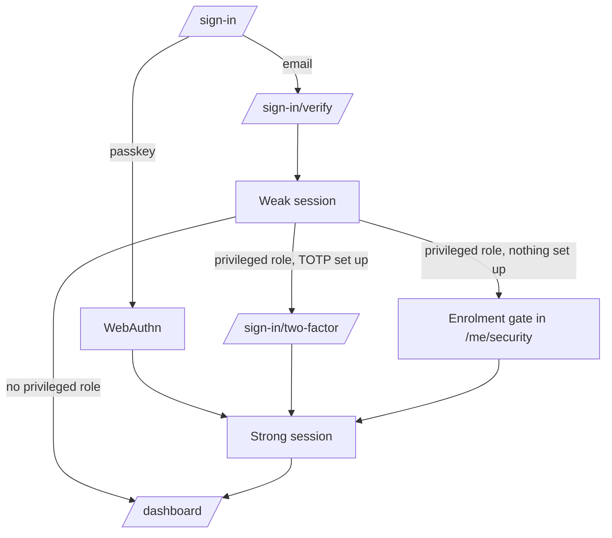
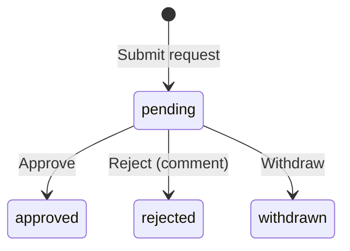
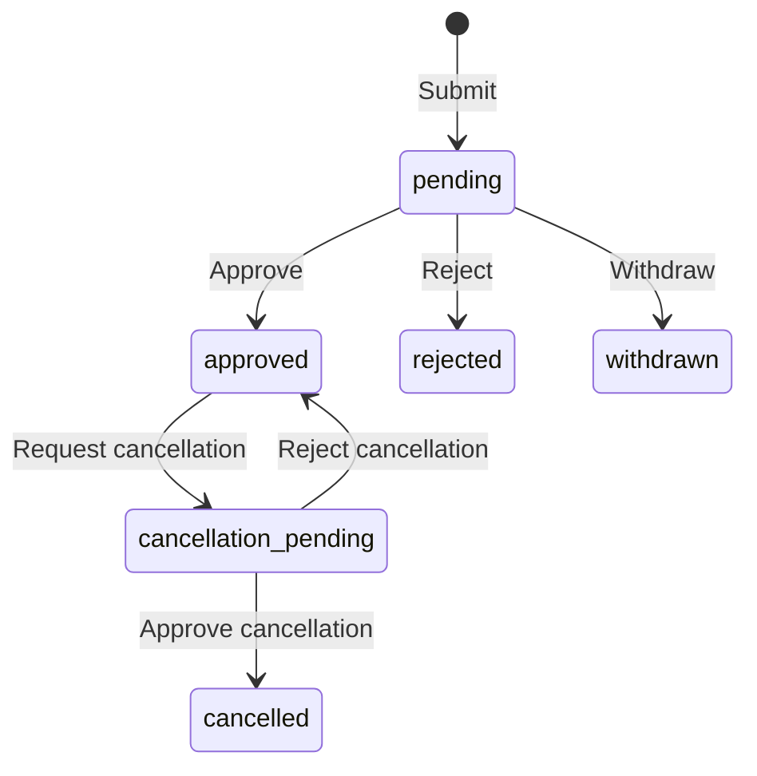
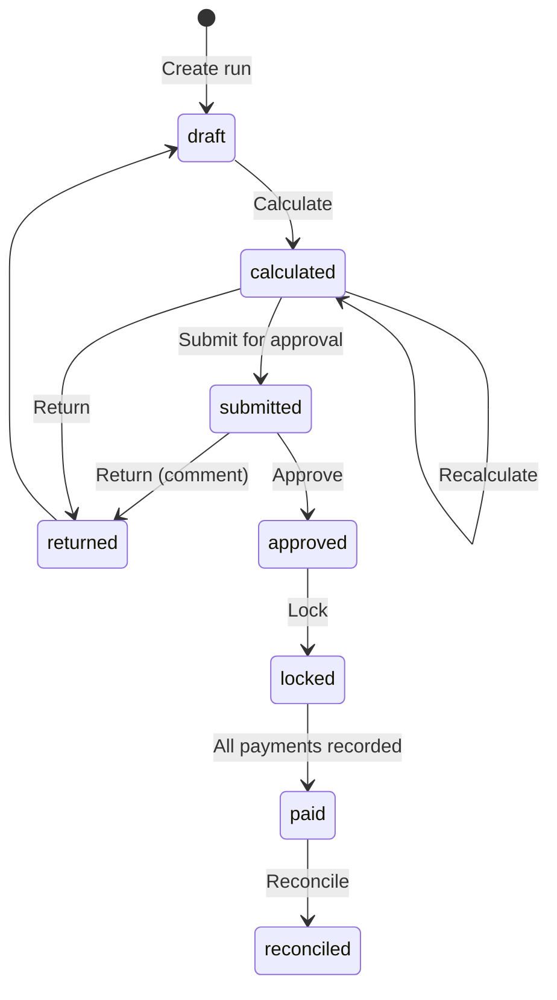

# User flows

Step-by-step flows for every multi-step task in v1. Each flow names the actor, the screens (routes from INFORMATION-ARCHITECTURE.md), the API calls, the state transitions (from `docs/03-architecture/DOMAIN-MODEL.md` section 5) and the failure paths. Endpoint paths are from `docs/05-backend/API-CATALOGUE.md` (relative to `/api/v1`), which owns exact paths and payloads and wins on any difference. Requirement IDs (FR-*) are from SRS v1.0 and `docs/00-requirements/SRS-v1.1-CHANGES.md`; user stories are in `docs/00-requirements/USER-STORIES.md`.

Conventions used below:

- "Primary" is the one Red Fill button on the screen.
- "Confirm dialog" is the confirmation pattern in COMPONENT-SPECS.md section 12.
- Every mutation that the API accepts writes an audit entry; flows do not repeat this.
- Emails are sent asynchronously after the change is saved, usually within a minute, with retries if sending fails (D-025, `docs/05-backend/JOBS-AND-OUTBOX.md`). The UI never waits for an email and never says "email sent"; it says "We'll email ..." or names who will be notified.

## 1. Sign-in (passwordless, D-033)

Stories: US-AUTH-003, US-AUTH-004, US-AUTH-005, US-AUTH-006, US-AUTH-007.

### 1.1 Sign in with a passkey

Actor: any user with a registered passkey.

1. `/sign-in` shows the email field and a secondary button **Sign in with a passkey**. The browser may also offer the passkey through autofill (conditional mediation) when the user focuses the email field.
2. User chooses the passkey; the browser runs WebAuthn.
3. API verifies the assertion and creates a **strong** session (a passkey satisfies MFA, SECURITY-MODEL section 2).
4. Redirect to the `redirect` search parameter if it is a same-origin app path, else `/dashboard`.

Failures: user cancels the browser prompt, so stay on `/sign-in` with no error; unknown passkey, so show "We couldn't sign you in with that passkey. Use your email instead."; `ACCOUNT_SUSPENDED`, so show the generic message in section 1.5.

### 1.2 Sign in with an email code

1. `/sign-in`: user enters email, primary **Send code**.
2. API sends a 6-digit code by email (always responds the same way whether or not the email exists, to avoid account probing).
3. `/sign-in/verify`: six-digit input (one field, `inputmode="numeric"`, `autocomplete="one-time-code"`), primary **Verify**. Secondary: **Send a new code** (disabled for 60 seconds, shows countdown), **Use a different email**.
4. On success the session is **weak**. If the user holds a role that requires MFA (`system_admin`, `hr_admin`, `payroll_officer`, `director`, `auditor`), go to 1.3. Otherwise go to the redirect target.
5. After the first successful sign-in on a device without a passkey, show the **Add a passkey** prompt (1.6) once per device.

Failures: `OTP_INVALID` (wrong or expired code) shows the field error "That code isn't right or has expired. Check the email or send a new code."; too many attempts (`RATE_LIMITED`) shows "Too many attempts. Try again in N minutes." with the server's retry time.

### 1.3 Step-up with an authenticator app (TOTP)

1. `/sign-in/two-factor`: six-digit TOTP input, primary **Verify**. Link: **Use a recovery code** switches the input to a recovery code field.
2. On success the session becomes **strong**; continue to the redirect target.
3. If the user has a privileged role but has not set up TOTP or a passkey yet, route to the **enrolment gate** instead: `/me/security` in a restricted mode that only allows adding a passkey (recommended) or an authenticator app, then shows recovery codes once. Navigation is disabled until enrolment completes (D-006).

### 1.4 Step-up during a session

Triggered when an API call returns `MFA_REQUIRED` (weak session hitting a privileged route) or `REAUTH_REQUIRED` (sensitive action and last authentication older than 15 minutes, SECURITY-MODEL section 7).

1. A modal dialog opens: "Confirm it's you". Options in order: **Use passkey** (primary if a passkey exists), **Enter authenticator code**, or for `REAUTH_REQUIRED` without TOTP, **Email me a code**.
2. On success the dialog closes and the original request is retried once with the same idempotency key.
3. On cancel the action is not performed; the page shows an inline note "Action cancelled. Nothing was changed."

### 1.5 Suspended or deactivated account

The API returns `ACCOUNT_SUSPENDED` only after a valid code or passkey, so the account's existence is never revealed to someone who doesn't control it. The UI shows: "We couldn't sign you in. If you think this is wrong, contact HR."

### 1.5a Lost passkey and authenticator

There is no public self-service recovery (`docs/05-backend/AUTH-IMPLEMENTATION.md` section 6). `/recover` explains the options: non-privileged users sign in with an email code; privileged users use a recovery code at the two-factor step; anyone else asks HR or the system administrator, who uses **Reset sign-in methods** (flow 2, `POST /users/{id}/reset-auth`). That removes passkeys and the authenticator, signs the user out everywhere and emails a sign-in link; the user then enrols again (1.3 step 3).

### 1.6 Add a passkey

From the post-sign-in prompt or `/me/security`: primary **Add a passkey**, browser registers a credential, the user names it (default "This device, <browser>"), the list refreshes. Removing a passkey asks for confirmation and, for privileged users, is blocked if it would leave no strong factor.

## 2. Invitation and first sign-in

Stories: US-AUTH-001, US-AUTH-002, US-AUTH-008.

Actor: `hr_admin` or `system_admin` (`user.manage`), then the invited person.

1. `/settings/users` or the employee's overview tab: **Invite to sign in** (an employee record may exist without an account, FR-AUTH-009). Dialog fields: email (prefilled with work email), roles (only with `role.manage`; default none, `employee` is derived from the link).
2. API creates the user as `invited` and queues the invitation email. Toast: "Invitation created. We'll email <email>."
3. The invitee opens `/accept-invite/$token`. Valid token: show company name, their name and a primary **Continue**, which signs them in with a one-time email code (flow 1.2) and moves the account to `active`.
4. First sign-in: show the passkey prompt (1.6). Privileged roles go through the enrolment gate (1.3 step 3).
5. Expired or revoked token: "This invitation has expired. Ask HR to send a new one."

Admin follow-ups on `/settings/users`: **Resend invitation** (`POST /users/{id}/invitations/resend`), **Revoke invitation** (deactivates the invited user), **Suspend**, **Reactivate**, **Deactivate**, **Reset sign-in methods** (level 4 confirmation, re-auth). Suspend and deactivate use a confirm dialog that states: "<Name> will be signed out on all devices."

## 3. Attendance check-in and check-out

Stories: US-ATT-001, US-ATT-002, US-ATT-003.

Actor: employee with `attendance.check_in.own`.

1. Dashboard widget, `/attendance` or the top-bar shortcut shows the current state: "Not checked in", "Checked in at 09:12", "Checked out at 18:05".
2. Primary **Check in**: `POST /attendance/check-in` with an empty body; the server takes the employee from the session (FR-ATT-012). The client sends an `Idempotency-Key` so a double tap creates one event.
3. Success: the panel switches to "Checked in at hh:mm" and starts a worked-time counter (client-side display only; the server computes the record).
4. Primary **Check out** later: `POST /attendance/check-out`.
5. The day's status (`present`, `short_hours`, `missed_core`, `missing_punch` ...) appears after the server evaluates it; the UI shows the server value, never its own calculation.

Failures: `ALREADY_CHECKED_IN` or `NOT_CHECKED_IN` refreshes the panel and shows "You're already checked in."; network failure keeps the button enabled and shows "We couldn't reach the server. Try again."; a non-working day still allows check-in and shows a neutral note "Today is a non-working day in your schedule."

## 4. Attendance correction

Stories: US-ATT-004, US-ATT-005.

Actor: employee; reviewer is the direct manager, or `hr_admin` when there is no manager (SECURITY-MODEL section 6).

1. `/attendance`, month view: select a day with status `missing_punch`, `absent`, `short_hours` or any past day; secondary **Request correction**.
2. Drawer form: work date (read-only), proposed check-in time, proposed check-out time, reason (required, 10 to 500 characters). Show the original events read-only above the form.
3. Primary **Submit request** (`POST /attendance/corrections`) creates the correction as `pending`; the approval appears in the reviewer's inbox and the reviewer is emailed.
4. Reviewer opens `/approvals/$approvalId`: sees original events, proposed times, reason, the employee's schedule for the day. Primary **Approve**; secondary **Reject** (comment required on reject).
5. Approved: a `correction` event is appended, the record is recalculated, the employee is emailed. Rejected: the employee sees the decision and comment on the request.
6. Employee may **Withdraw** while `pending`.

## 5. Leave request, approval and cancellation

Stories: US-LEAVE-002, US-LEAVE-003, US-LEAVE-004, US-LEAVE-005, US-WF-001.

Actor: employee with `leave.request.own`; approver as in section 4.

### 5.1 Request

1. `/leave` shows balances (StatBar) and the request list. Primary **Request leave** opens `/leave/new`.
2. Form: leave type (only types the employee is eligible for), start date, end date, unit (`day` or `half_day`; for half day a single date and `first_half` or `second_half`), reason (required when the leave type requires it).
3. As dates change the form calls `POST /leave/requests/preview` and shows "N working days" and "Balance after this request: M days". Holidays and weekends inside the range are listed. The preview is advisory; the submit response is authoritative.
4. Primary **Submit request**. The request is created directly in `pending` (v1 exposes no leave drafts), the balance is reserved (D-016), the approver is emailed. Redirect to `/leave/requests/$requestId`.
5. Failures on the date fields: `INSUFFICIENT_BALANCE` "You have N days of <type> available."; `OVERLAPPING_LEAVE` "You already have leave on <dates>."; `LEAVE_NO_WORKING_DAYS` "These dates are all weekends or holidays."; `LEAVE_NOT_ELIGIBLE` "You aren't eligible for <type> yet."

### 5.2 Approve or reject

1. Approver opens the inbox item: employee, type, dates, working days, balance before and after, team members already on leave on those dates (if `leave.read.team`).
2. Primary **Approve**. Secondary **Reject** requires a comment. Approve sends an `Idempotency-Key`.
3. The approver cannot act on their own request; the inbox never lists it (FR-WF-004).

### 5.3 Withdraw and cancel

- `pending`: employee **Withdraw request** (confirm dialog). Reservation is released.
- `approved` and the start date is in the future or today: employee **Request cancellation**, which moves to `cancellation_pending` and goes to the approver. Approved cancellation moves to `cancelled` (ledger reversal); rejected cancellation returns to `approved`.
- HR with `leave.request.review.all` can act on behalf; the UI shows a banner "You are acting on behalf of the approver. This is recorded."

Leaving the form with unsaved input shows the discard guard (FORMS-AND-VALIDATION.md); there is no leave draft in v1.

## 6. Transport reimbursement claim (D-020, FR-REIM-001 to FR-REIM-004)

Stories: US-REIM-001 to US-REIM-004.

Actor: employee with `reimbursement.request.own`; approver as in section 4; payroll officer includes it in pay.

1. `/reimbursements`, primary **New claim** opens `/reimbursements/new`.
2. Form: category (`transport`, fixed in v1), date of travel, amount in BDT (2 decimals), description (required), receipt (optional upload: JPG, PNG or PDF, up to 10 MB; images are compressed in the browser before upload).
3. Primary **Submit claim** creates the claim (`POST /reimbursement-claims`, status `draft`) and submits it (`POST /reimbursement-claims/{id}/submit`) in one user step. **Save draft** only creates it; a draft can be edited or deleted. After submission the claim can't be edited, only withdrawn while `submitted` (FR-REIM-004). The approver is emailed.
4. Approver: **Approve** or **Reject** (comment required).
5. Approved claims are picked up by the next payroll run (status `included`), then `paid` when that run is paid. The claim page shows which run and period it belongs to.
6. If the run is returned to draft, the claim shows `approved` again; the UI explains "Waiting for the next payroll run."

## 7. Payroll run end to end

Stories: US-PAY-002 to US-PAY-010.

Actor: `payroll_officer` (`payroll.prepare`, `payroll.lock`, `payroll.pay`); approver holds `payroll.approve` (payroll officer or director). All money is shown as `৳` with two decimals in mono tabular figures.

1. **Create.** `/payroll`, primary **Create payroll run**. Dialog: period (year, month; defaults to the current month), run type `regular` (or `off_cycle` if a regular run exists). Creates `draft`.
2. **Prepare.** Run page, Items tab lists eligible employees (active or employed for part of the period). Adjustments tab: add approved `PayrollAdjustment` entries; approved reimbursement claims are listed automatically.
3. **Calculate.** Primary **Calculate**. Sends an `Idempotency-Key`. The server computes items and line items (base salary, proration, reimbursements, additions, deductions). Status `calculated`. Totals bar: employees, gross, deductions, net.
4. **Validate.** Validation tab runs automatically after calculation and on demand (**Run checks**). It lists blocking errors (missing salary structure, duplicate employee, negative net) and warnings (net change over the configured threshold against last month, new joiner, leaver). Submit stays disabled while blocking errors exist.
5. **Submit.** Primary **Submit for approval**. Confirm dialog shows the totals. Status `submitted`; approvers are emailed.
6. **Approve.** The approver reviews totals, validation results and the items table. Primary **Approve run**; secondary **Return to draft** (comment required).
   - If the approver also prepared or calculated the run, the dialog shows the self-approval notice: "You prepared this run. Approving it yourself is allowed but flagged for review." A justification field (required, at least 20 characters) and a checkbox "I have reviewed the totals and validation results" must both be completed (D-007). The run then shows a "Self-approved" badge permanently.
7. **Lock.** Primary **Lock run**. Requires re-auth (`REAUTH_REQUIRED` if older than 15 minutes). Confirm dialog with typed confirmation of the run number (for example `PR-2026-11-01`). After lock nothing in the run can be edited; corrections go to an adjustment in a later run (FR-PAY-011).
8. **Record payments.** Payments tab lists every item with net amount and payment status `unpaid`. For each employee or in bulk: method (`cash` or `cheque`), date, cheque number (required for cheque), reference or acknowledgment note. Primary **Record payment**. Failed or cancelled payments are recorded with a reason. When every item is `paid`, the run moves to `paid`.
9. **Publish payslips.** Available from `locked` (`POST /payroll/runs/{id}/publish-payslips`). Primary **Publish payslips** (confirm dialog: "N employees will be able to see their payslip for <Month YYYY>. We'll email them."). Employees see them at `/payslips`; the page loads `GET /payroll/payslips/{id}` and the PDF is generated in their browser from that snapshot (D-037).
10. **Reconcile.** Reconciliation tab compares gross, deductions, net and recorded payments; differences are listed per employee. Primary **Mark as reconciled** when the difference is zero.

Failures: `VERSION_CONFLICT` reloads the run and shows "This run was changed by someone else. Review the latest version."; `INVALID_TRANSITION` reloads and shows the current status; `PAYROLL_RUN_EXISTS` on create offers to open the existing run; `PAYROLL_MISSING_SALARY_STRUCTURE`, `PAYROLL_NEGATIVE_NET` or `PAYROLL_CURRENCY_MISMATCH` on submit opens the Validation tab with one row per item; `PAYROLL_MIDPERIOD_SALARY_CHANGE_UNCONFIRMED` on calculate links to `/settings/payroll`; `PAYMENT_AMOUNT_MISMATCH` on a payment keeps the form open with the amount field flagged; `SELF_APPROVAL_NOTE_REQUIRED` focuses the justification field.

## 8. Profile change request

Stories: US-EMP-008.

Actor: employee (`profile_change.request.own`); reviewer `hr_admin` (`profile_change.review.all`).

1. `/me`, secondary **Request a change** on a section (contact details, emergency contacts, identity). Editable fields come from the server's allowed list.
2. The form shows current values and new values side by side; reason optional.
3. Primary **Submit request**, status `pending`. HR is emailed.
4. HR reviews in `/approvals/$approvalId` with a field-by-field diff. **Approve** applies the changes (and creates an employment event when relevant); **Reject** requires a comment.
5. The employee can **Withdraw** while pending. Approved changes appear immediately on `/me`.

## 9. Documents

Stories: US-DOC-001 to US-DOC-003.

### 9.1 Upload (HR, `document.manage`)

1. Employee profile, Documents tab, primary **Upload document**.
2. Dialog: file (drag and drop or browse; allowed types and size shown up front), category (`document_category` enum), title, issue date, expiry date (optional), visible to employee (checkbox; default on for `contract`, `certificate`, `policy`; off for `identity` until the owner decides, see open questions).
3. Client validates type and size before upload, then shows progress. Server re-validates (type sniffing, size) and stores privately in R2.
4. Uploading a file to an existing document creates a new version; the previous version stays in the history list.

### 9.2 Download (employee or HR)

1. Click a document row; secondary **Download**.
2. The browser calls `GET /documents/{id}/download`; the response streams the file as an attachment. No public URLs are shown or copied.
3. Restricted categories record an access audit entry; the UI does not announce this.

## 10. Offboarding

Stories: US-EMP-004, US-EMP-009.

Actor: `hr_admin`; finance review by `payroll_officer`. SRS 7.5 describes checklist tasks and asset checks, which are P1 (asset tracking and checklist templates are post-release features, SRS 3.12). v1 covers the steps below.

1. Employee profile, **More** menu, **Start separation**. Dialog: exit type, notice start date, last working day, reason. Status moves to `notice_period` (or directly `separated` for immediate separation) on the effective date.
2. Account access: the dialog offers "Deactivate sign-in on the last working day" (checked by default). The daily job applies it.
3. Finance: the employee is included in the payroll run for the final period, prorated to the last working day (D-022). Pending claims and adjustments appear in that run's validation warnings.
4. On the effective date the status becomes `separated`. HR can later **Archive** (confirm dialog: "History stays available in reports and audit."). Archived employees are hidden from default lists; a filter shows them.

## Owner questions (decided, D-049)

All decided on 2026-10-23 (D-049): the default or v1 behaviour written in each item is the decision.

- Should employees be able to download their own `identity` documents (national ID scans), or only HR? The flow defaults the visibility checkbox to off for that category.
- Validation warning threshold for month-on-month net pay change (proposed default: 20%). Payroll owner to confirm.
- Offboarding exit types (resignation, termination, end of contract, retirement, other) need confirmation by HR before the enum is fixed.
- Can an approved leave be cancelled after its start date (partial cancellation)? v1 allows cancellation only up to and including the start date.
